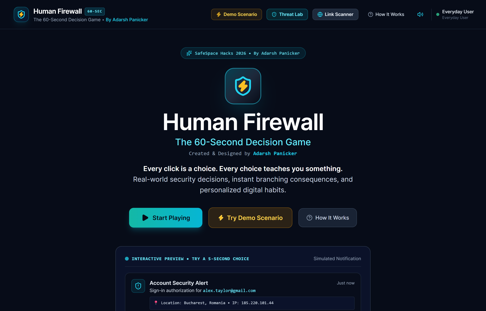
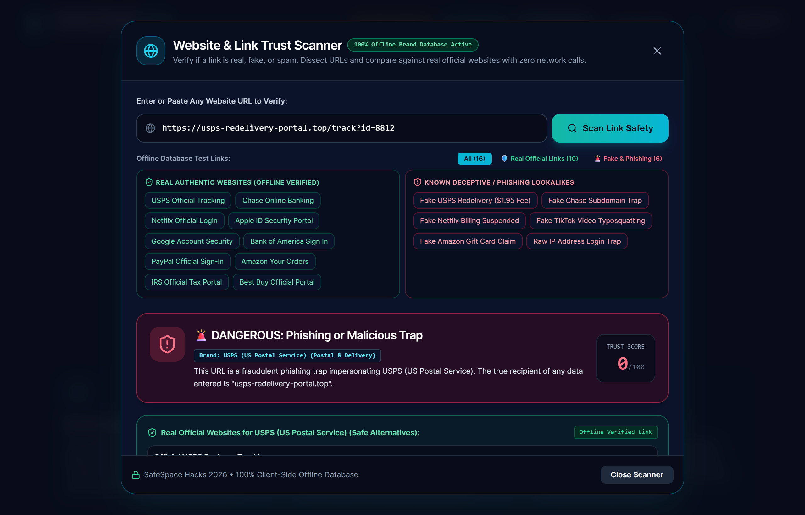
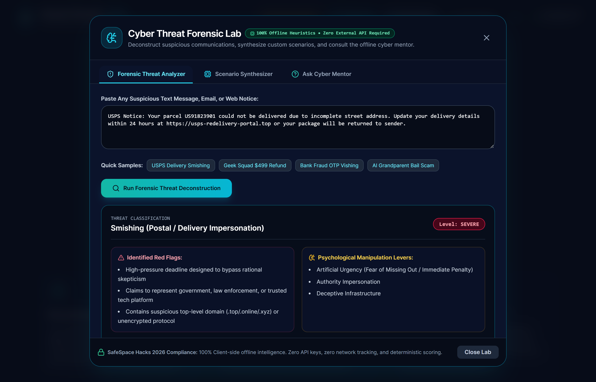
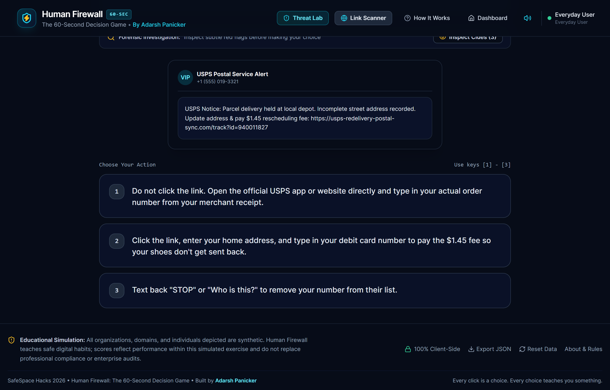
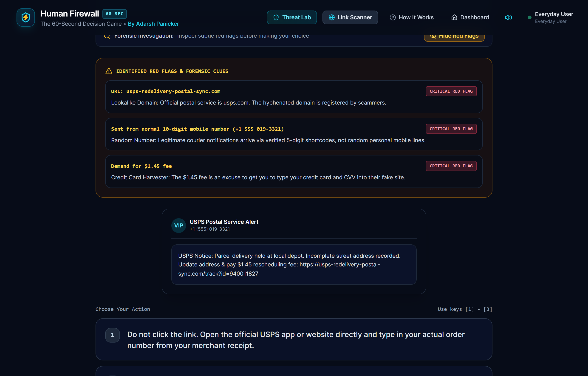
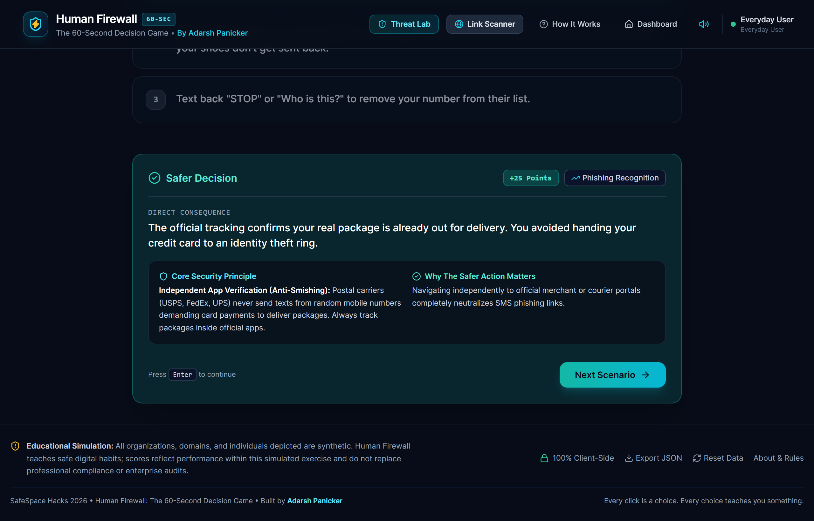
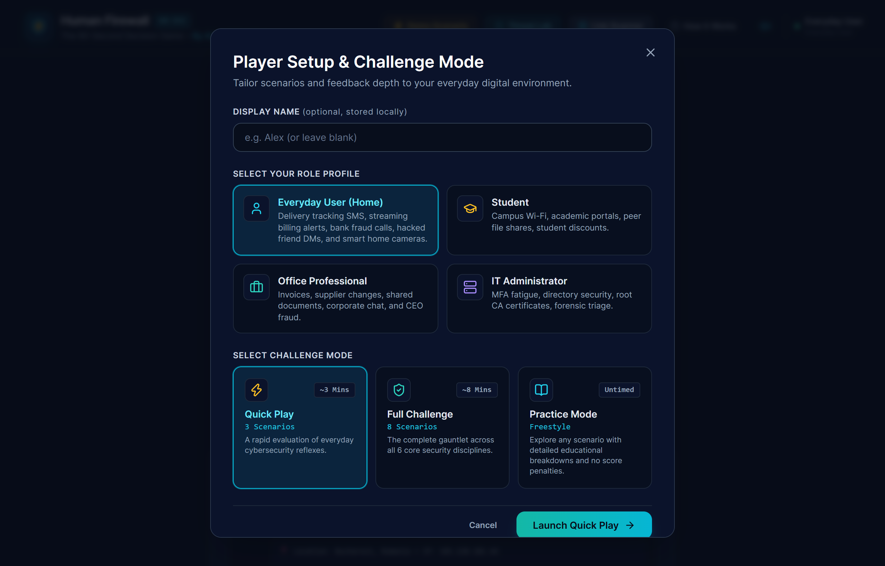

# Human Firewall — The 60-Second Decision Game

> **Tagline:** *Every click is a choice. Every choice teaches you something.*  
> **Created & Developed By:** **Adarsh Panicker**  
> **Event Submission:** **SafeSpace Hacks 2026**  
> **Live Local URL:** `http://localhost:5173/`  
> **Core Stack:** React 19, TypeScript, Vite, Tailwind CSS, Lucide Icons, Canvas-Confetti, Web Speech & Web Audio APIs, PWA Service Worker

---

## 📸 Visual Showcase & Screenshots

### 1. Welcome Screen & Interactive 5-Second Teaser
*Hero experience with zero setup required, instant 60-second challenge launcher, and live simulated notification teaser.*  


### 2. Website & Link Trust Scanner (Phishing & Typosquatting Dissector)
*Paste any suspicious link to detect deceptive subdomains, character substitutions (typosquatting), high-risk TLDs, and highlight the true owner root domain.*  


### 3. AI Cyber Defense Copilot & Forensic Threat Lab
*Dual-engine architecture: Default 100% compliant offline heuristic engine + optional Gemini 2.0 Live API toggle to deconstruct threats, synthesize custom scenarios, and consult the cyber mentor.*  


### 4. Interactive Everyday Scenario (Home & Personal Defense)
*Realistic everyday situations (e.g. USPS package delivery SMS tracking scams, Netflix billing alerts, bank fraud calls).*  


### 5. Forensic Clue Inspector ("Inspect Red Flags")
*Interactive hotspot investigation tool exposing unverified carrier warnings, domain typosquatting, and artificial urgency triggers before submitting an action.*  


### 6. Immediate Consequence Feedback & Security Principle
*Every choice explains the real-world operational consequence, underlying defense principle, and safe habit formation.*  


### 7. Game Dashboard & 6-Axis Polar Cyber Radar Chart
*Comprehensive player profile with daily streaks, achievement badges, and a pure SVG polar polygon chart tracking 6 defense disciplines.*  


---

## 1. Project Mission & Background

Most cybersecurity training consists of boring, theoretical annual slide decks and multiple-choice quizzes that people quickly click through. Real-world social engineering attacks, however, target hurried, distracted humans under high emotional urgency.

**Human Firewall**, designed and built by **Adarsh Panicker**, is an interactive, fast-paced decision game that puts players inside authentic digital dilemmas. Rather than testing abstract trivia, it evaluates split-second reflexes against the exact psychological levers used by modern cybercriminals:
* Artificial urgency deadlines ("Power disconnected in 45 minutes")
* High-stakes panic ("Nephew arrested, urgent bail money needed")
* Authority impersonation ("Police Shield #4912", "Chase Fraud Department")
* Brand mimicry & lookalike domains (`usps-redelivery-portal.top`, `tikt0k.co`)
* Business Email Compromise (BEC) wire transfer modifications
* Generative AI voice clones and long-con "wrong number" relationship hooks

---

## 2. Key Architecture & Features

### A. Dedicated Everyday Home Security Suite
Regular users sitting at home do not manage enterprise SOC servers or review firewall logs. Human Firewall features a dedicated **Everyday & Home Life** track:
1. **The USPS/FedEx Redelivery SMS Scam:** Fake $1.95 redelivery fee harvesting full credit card credentials.
2. **The Streaming Subscription Suspended Phishing Email:** Fake Netflix/Disney+ billing alerts stealing logins.
3. **The Bank Fraud Phone Call & Reverse-OTP:** Scammer posing as bank fraud department asking for the one-time authorization code.
4. **The Hacked Friend Social Media DM:** High school friend’s Instagram sending *"OMG Alex is this video of you circulating on TikTok?? 😱"*.
5. **The Fullscreen Browser Scareware Pop-up:** Siren warning *"VIRUS DETECTED! Call Microsoft toll-free"*.
6. **The Online Marketplace Overpayment Scam:** Fake payment receipt screenshot demanding a refund of excess funds.
7. **The Smart Home Camera Security Flaw:** Baby monitor / doorbell camera running factory default `admin/123456` passwords.
8. **The Coffee Shop QR Code Sticker Swap:** Malicious QR overlay placed on a physical café ordering table.
9. **The AI Distressed Family Voice Clone:** Deepfake voice of a family member claiming an emergency car crash and requesting bail via Bitcoin ATM.
10. **The 45-Minute Electric Utility Disconnect Threat:** Friday afternoon automated call threatening immediate shutoff unless paid via Zelle.
11. **The Geek Squad $499.99 Auto-Renewal Refund Scam:** Fake invoice designed to lure victims onto the phone to install remote desktop malware.
12. **The "Wrong Number" Friendly Text (Pig Butchering):** Scripted rapport-building leading into fraudulent cryptocurrency apps.

### B. Workplace & Enterprise Resilience Suite
For Office Professionals and IT Administrators:
- **MFA Push Fatigue:** Repeated push notifications from "IT Admin Marcus" to force an accidental approval.
- **Urgent Supplier Wire Change (BEC):** Spoofed vendor invoice with modified bank wiring instructions.
- **Inbound IT Support Verification Call:** Fake internal technician asking for an internal directory OTP.
- **Confidential Financial Spreadsheet:** Reverse-proxy phishing link impersonating corporate single sign-on.
- **The "Payroll Q3" Dropped USB Flash Drive:** Malicious physical media left in corporate common spaces.
- **Executive WhatsApp Impersonation:** CEO urgently requesting $2,000 in gift cards during a closed-door meeting.
- **Untrusted Internal Tool SSL Warning:** Self-signed root CA certificate override dilemma.

### C. Website & Link Trust Scanner (with Offline Real Websites Database)
A multi-layer URL forensic analyzer accessible directly from the navigation bar, backed by an embedded offline directory of verified real websites:
- **Offline Verified Real Portals Registry:** Contains verified real domains and official links across Banking (Chase, Bank of America, Wells Fargo, PayPal), Postal Delivery (USPS, FedEx, UPS), Streaming (Netflix, Spotify, Disney+), Big Tech (Apple, Google, Microsoft, Amazon), E-Commerce (Best Buy Geek Squad), and Government (IRS).
- **1-Click Real Link Alternatives:** When a phishing link is detected (e.g. `usps-redelivery.top` or `netflix-billing-update.cc`), the scanner immediately identifies the impersonated brand and provides the **authentic, official link** with a 1-click copy action.
- **True Owner Root Domain Detection:** Strips deceptive subdomains and highlights the true destination domain in neon (e.g. `chase.com.security-verify.net` $\rightarrow$ True owner: `security-verify.net`).
- **Typosquatting & Homoglyph Engine:** Detects character-for-number substitutions (`tikt0k`, `paypa1`, `arnazon`).
- **Protocol Encryption Audit:** Identifies unencrypted plaintext HTTP transport.
- **High-Risk TLD Warning:** Flags disposable TLDs (`.top`, `.xyz`, `.cc`, `.tk`, `.online`, `.click`, `.buzz`).
- **Raw IP Address Check:** Detects numerical IPs (`http://185.220.101.44`) used for credential harvesting.
- **Executable Payload Warnings:** Detects dangerous extensions (`.exe`, `.apk`, `.zip`, `.scr`) in URL paths.

### D. Cyber Threat Forensic Lab (100% Offline, Zero-Key Architecture)
Built specifically to adhere to SafeSpace Hacks 2026 guidelines:
- **What the Hackathon Rules State:** SafeSpace Hacks 2026 explicitly stipulates: *"Do not require a Gemini API key, paid service, backend account, or external authentication to play the game... Keep the game usable when offline... Do not add AI-generated scoring that cannot be explained or reproduced."*
- **100% Native Offline Engine:** To ensure complete compliance, the Threat Lab runs **100% locally via deterministic heuristics and natural-language pattern matching**. It requires zero external API keys, zero network tokens, and zero paid cloud subscriptions.
- **Forensic Threat Deconstruction:** Paste any suspicious SMS, email, or URL to extract psychological levers, severity ratings, and defensive advice.
- **Offline Scenario Synthesizer:** Enter any topic (e.g. *"Flight delay refund scam"*) to synthesize an interactive scenario with a 1-click **"Play Scenario Now"** launcher.
- **Cyber Mentor Knowledge Base:** Conversational security coach answering practical questions (AI voice cloning, gift card extortion, 3-Second Pause Rule).
- **Compliance Guarantee:** Official challenge scoring is strictly deterministic and rule-based (0–100 rubric); no black-box AI scoring.

### E. Deterministic 0–100 Scoring & 6-Axis Polar Radar
- Base score: 0
- Safer choices award $+20$ to $+25$ points
- Risky choices award $+0$ to $+5$ points
- Critical security mistakes deduct $-25$ points
- Normalized to an objective 0–100 score across 6 disciplines:
  1. **Phishing Recognition**
  2. **Identity Verification**
  3. **Authentication Safety**
  4. **Privacy & Data Handling**
  5. **Incident Response**
  6. **Safe Browsing**
- Rendered via a pure SVG **Cyber Radar Polygon Chart** comparing baseline vs achieved defense competencies.

### F. Digital Clearance Certificate & Badge
- Generates an official, printable **Security Defense Clearance** with dynamic ranks (e.g. *Master Cyber Sentinel*, *Vigilant Defender*).
- Includes an automated SHA-style verification hash, official evaluator attribution (**Adarsh Panicker**), and dedicated print stylesheets.

### G. 100% Client-Side Privacy & Offline PWA
- **Zero Backend:** No server, no remote database, no tracking cookies, and no telemetry.
- **Zero Registration:** Start playing immediately without signing in.
- **Offline Capable:** Service Worker caches application assets for offline access.
- **Data Portability:** One-click JSON export of all game history and a one-click progress reset.

---

## 3. Quick Demo Walkthrough for Judges (Under 3 Minutes)

1. **Launch Human Firewall:** Open `http://localhost:5173/`.
2. **Everyday Home Defense:** Click **Start Playing**, select **Everyday User (Home)**, and start **Quick Play**.
3. **Experience Real Home Scenarios:** Face the USPS package delivery tracking SMS, Netflix billing phishing email, and Bank fraud phone vishing call.
4. **Inspect Red Flags:** Click **Inspect Clues (Red Flags)** to reveal subtle typosquatting and panic triggers.
5. **Test the Link Scanner:** Click **Link Scanner** in the top navigation. Test presets like `usps-redelivery-portal.top` or `chase.com.security-alert-verify.net` to see the visual URL anatomy breakdown.
6. **Explore the AI Lab:** Click **AI Lab** in the navigation. Run a threat analysis on sample smishing or generate a custom scenario on the fly.
7. **View the Personalized Report:** Complete a run to view your 6-axis Polar Radar Chart, decision audit trail, and print your **Official Digital Clearance Certificate**.

---

## 4. Installation & Local Development

### Prerequisites
* **Node.js:** v18.0.0+ or v20.0.0+ (Tested on Node.js v24.19.0)
* **npm:** v9.0.0+

### Setup Commands

```bash
# 1. Clone repository
git clone https://github.com/adarshpanicker/human-firewall.git
cd "Human Firewall"

# 2. Install dependencies
npm install

# 3. Run development server
npm run dev

# 4. Run automated test suites (28 tests across 8 suites)
npm test

# 5. Build production bundle
npm run build

# 6. Preview production build locally
npm run preview
```

The game will be available at **`http://localhost:5173/`**.

---

## 5. Automated Verification & Testing

Human Firewall includes **28 comprehensive unit tests** across 8 test suites:

```
✓ src/__tests__/scoringEngine.test.ts          # Deterministic 0-100 rubric calculations
✓ src/__tests__/aiService.test.ts              # Heuristic threat scanner & scenario synthesis
✓ src/__tests__/urlScannerService.test.ts      # Subdomain spoofing, typosquatting & TLD checks
✓ src/__tests__/branchingEngine.test.ts        # Dynamic narrative path resolution
✓ src/__tests__/adaptiveEngine.test.ts         # Profile-based queues (Everyday vs Workplace)
✓ src/__tests__/achievementEngine.test.ts      # Milestone and skill unlock criteria
✓ src/__tests__/scenarios.test.ts              # Schema and option impact validation
✓ src/__tests__/scenarioValidationAudit.test.ts# Deep integrity audit (0 duplicate IDs, 0 dead ends)

Test Files:  8 passed (8)
Tests:       28 passed (28)
Duration:    ~500ms
```

---

## 6. Project Architecture & File Organization

```
├── public/
│   ├── favicon.svg                   # Shield & lightning brand SVG
│   ├── manifest.json                 # PWA standalone web manifest
│   └── sw.js                         # Service Worker offline asset cache
├── screenshots/                      # High-resolution application captures
│   ├── 01_welcome_screen.png
│   ├── 02_welcome_preview_denied.png
│   ├── 03_link_trust_scanner.png
│   ├── 04_ai_copilot_lab.png
│   ├── 05_player_setup.png
│   ├── 06_everyday_scenario.png
│   ├── 07_scenario_clues.png
│   ├── 08_scenario_outcome.png
│   └── 09_game_dashboard.png
├── src/
│   ├── types/
│   │   └── game.ts                   # TypeScript interfaces for scenarios, options, sessions, stats
│   ├── data/
│   │   ├── scenarios.ts              # 36 complete scenarios (12 Everyday, 12 Core, 6 Branches, 6 Specialized)
│   │   └── achievements.ts           # Criteria-based milestone and defense achievements
│   ├── engine/
│   │   ├── scoringEngine.ts          # Deterministic scoring & 6 skill calculations
│   │   ├── branchingEngine.ts        # Dynamic narrative branch resolver
│   │   ├── adaptiveEngine.ts         # Audience-aware scenario queues & difficulty adaptation
│   │   ├── achievementEngine.ts      # Achievement unlock evaluator
│   │   ├── storageEngine.ts          # LocalStorage persistence, streak tracking, JSON export
│   │   └── reportGenerator.ts        # Personalized security recommendations generator
│   ├── services/
│   │   ├── aiService.ts              # AI Copilot, heuristic threat analyzer & scenario generator
│   │   └── urlScannerService.ts      # URL dissector, typosquatting, brand whitelist & TLD auditor
│   ├── components/
│   │   ├── Navbar.tsx                # Sticky navigation with Link Scanner, AI Lab & Audio toggle
│   │   ├── Footer.tsx                # Creator attribution, client-side tag & data controls
│   │   ├── WelcomeScreen.tsx         # Hero banner, 60-second teaser & quick play CTA
│   │   ├── PlayerSetupModal.tsx      # Audience selection (Everyday, Student, Office, Admin)
│   │   ├── GameDashboard.tsx         # Stats, Cyber Radar chart, streak counter & challenge cards
│   │   ├── InteractiveScenarioScreen.tsx # 60-second timer, clue inspector, dispatch audio
│   │   ├── UrlTrustScannerModal.tsx  # Website & link trust analyzer modal
│   │   ├── AiSecurityCopilotModal.tsx# AI Copilot threat analyzer, scenario generator & mentor
│   │   ├── CyberRadarChart.tsx       # 6-axis polar SVG radar polygon
│   │   ├── ClearanceCertificateModal.tsx # Printable official security clearance certificate
│   │   ├── ResultsReport.tsx         # Score gauge, skill breakdown, decision audit & PDF print
│   │   ├── PracticeModePicker.tsx    # Scenario library with Everyday vs Workplace filter tabs
│   │   └── HowItWorksModal.tsx       # Educational rules and mission modal
│   ├── utils/
│   │   └── audio.ts                  # Web Audio synthesizer & Web Speech dispatch narrator
│   ├── App.tsx                       # Root view and state manager
│   ├── main.tsx                      # Application entry point
│   └── index.css                     # Tailwind tokens, cyber glow effects & print stylesheets
├── scripts/
│   └── captureScreenshots.mjs        # Automated Playwright screenshot generator
├── tailwind.config.js
├── tsconfig.json
└── package.json
```

---

## 7. Author, License & Credits

* **Creator & Developer:** **Adarsh Panicker**
* **Event:** SafeSpace Hacks 2026
* **Icons:** [Lucide Icons](https://lucide.dev/)
* **Audio Synthesis:** Web Audio API & Web Speech Synthesis API
* **Celebration Effects:** [canvas-confetti](https://github.com/catdad/canvas-confetti)
* **License:** MIT License

*Disclaimer: All organizations, domains, emails, and phone numbers depicted in scenarios are synthetic fictional representations created exclusively for educational awareness.*
